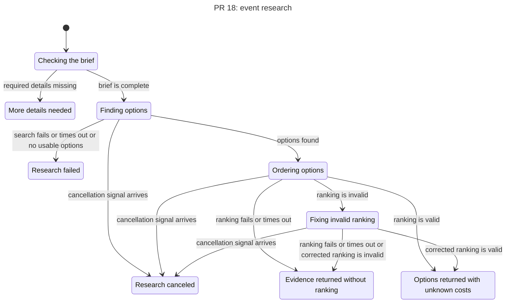
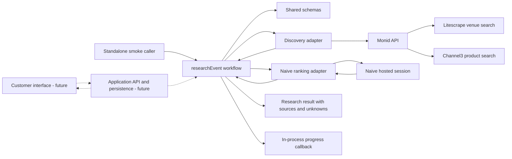

# Research workflow state chart

This chart describes the standalone research flow introduced by PR #18 at commit dac021afdfc555026ab6a0ee319a9c66474dc075.
It does not describe the customer-facing API, database persistence, bookings, or payments.



A complete brief starts discovery, then the model orders candidate IDs from the retrieved evidence.
The result remains partial because discovery alone does not verify the final event cost or supplier terms.
If ranking fails after candidates are found, the workflow can return the evidence without an ordered recommendation.
The workflow permits one correction when the ranking output is invalid.

## Architecture

The solid connections show the standalone workflow in this PR.
The dashed connections show planned application integration and are not implemented by this PR.



The discovery adapter calls Monid for venue and product leads and returns evidence to the workflow.
The Naive adapter receives the brief and retrieved candidates, then returns a ranking of candidate IDs.
The workflow validates the ranking and returns the original supplier evidence with unknown details preserved.
Naive does not call Monid in this implementation.
The result is not a confirmed booking or final quote.

The standalone caller manages the Naive adapter's checkpoint and cleanup operations.
Durable checkpoints, database-backed progress, and the application integration remain future work.

## Model check

The accompanying TLA+ model is a simplified representation of the intended research behavior, not a proof of the implementation.
TLC explored 13 model states and 23 steps.
The modeled rules held: ranking requires evidence, corrections are limited to one, budget fit remains unknown, and modeled terminal states are not deadlocked.
These are assumptions encoded in the model and do not independently establish that production code always enforces them.

The chart hides terminal self-loops and merges similar failure paths.
It does not model individual provider results, invalid identity or currency exceptions, resource cleanup, forced network interruption, persistence, UI behavior, or supplier transactions.
A cancellation signal models the workflow's abort input; this standalone PR does not establish that a customer cancellation button is connected.

To rerun the model, install the [statechart skill](https://github.com/cursor/plugins/tree/main/pstack/skills/statechart) and make Java 11 or newer and TLC available.
For example, set TLA2TOOLS to a local tla2tools.jar and JAVA to the Java executable, then run:

```sh
sh ~/.codex/skills/statechart/scripts/statechart docs/statecharts/pr18/Research.tla \
  --config docs/statecharts/pr18/Research.cfg \
  --view docs/statecharts/pr18/view.mjs \
  --out /tmp/we-gotchu-pr18-statechart-new
```
